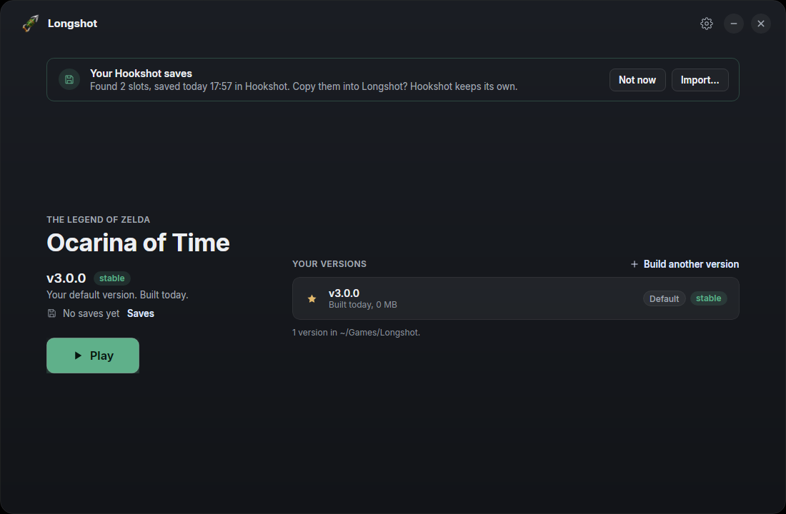
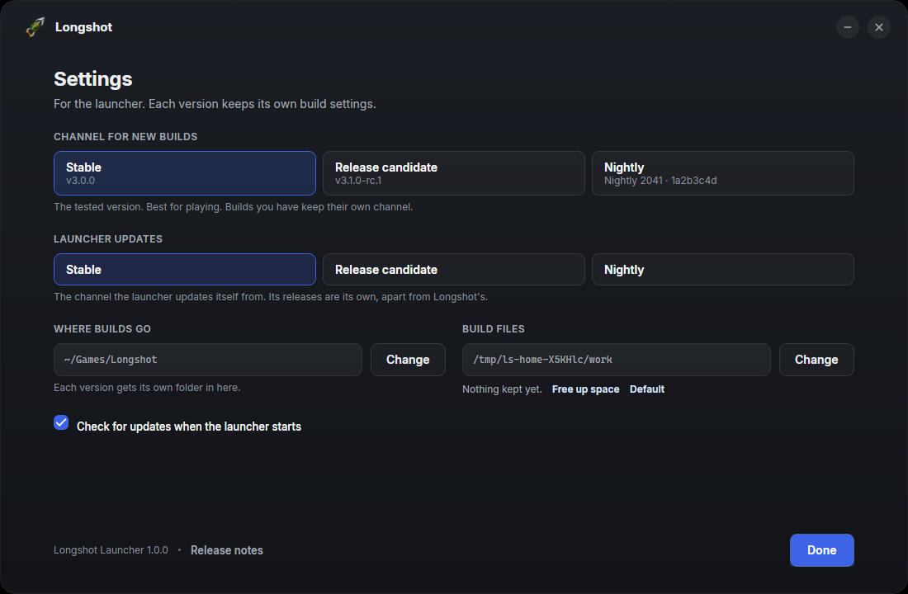
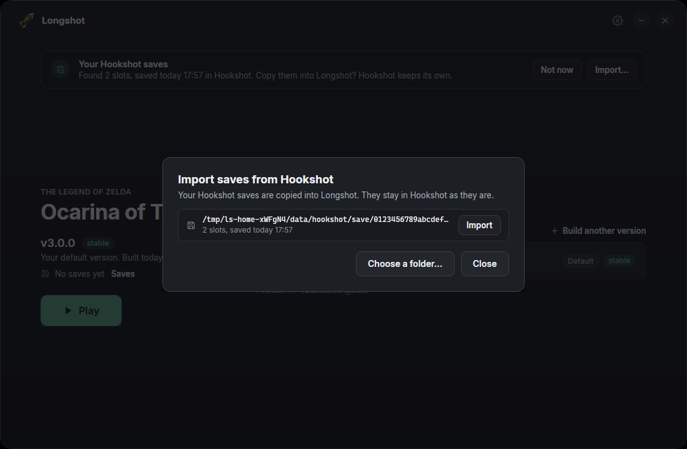

<h1 align="center">
  <br>
  <a href="https://git.magicbean.dev/MagicBeanDev/LongshotLauncher">
  
</a>

  <br>
  <b>Longshot Launcher</b>
  <br>
</h1>

<h4 align="center">Installs, builds, updates and starts <a href="https://git.magicbean.dev/MagicBeanDev/Longshot">Longshot</a>, the native PC version of The Legend of Zelda: Ocarina of Time (Nintendo Switch 2), on Windows & Linux.
</h4>


<p align="center">
  <a href="#what-it-does">What it does</a> |
  <a href="#download">Download</a> |
  <a href="#installing">Installing</a> |
  <a href="#using-it">Using it</a> |
  <a href="#saves">Saves</a> |
  <a href="#updates-and-channels">Updates</a> |
  <a href="#build-from-source">Build from source</a> |
  <a href="#credits">Credits</a> |
  <a href="#license">License</a>
</p>

The Longshot Launcher is the one program players download to get [Longshot](https://git.magicbean.dev/MagicBeanDev/Longshot).
It installs Longshot's builder, builds the game **on your PC, from your own copy of the game**, starts it, and keeps
the game and itself up to date. It is a separate project from Longshot, with its own repository and its own releases.

<p align="center">
  
</p>

> [!NOTE]
> Nothing of the game is in the launcher or downloaded by it. It downloads Longshot's builder, which builds the game from
> the copy you own. Don't ask where to get the game.

Discord: https://discord.gg/KX99srmQTe

## What it does

| | |
|---|---|
| **Builds the game** | A three-step wizard: it finds your game files while that version's builder downloads, then the settings (DLSS, FSR 4, language, where the game goes), then the build with one progress bar |
| **Several versions side by side** | Keep a stable build and a nightly; Play starts the default one; Set as default, Saves, Open folder and Delete for each |
| **Three channels** | `stable`, `rc` (release candidates) and `nightly`, chosen per build and, apart from that, for the launcher itself |
| **Installs Longshot's builder** | For each version, from Longshot's signed release: every file checked against its SHA-256 before it is used |
| **Updates the game** | Offers each build its channel's newest version and builds it from the game files the build kept |
| **Updates itself** | From its own signed releases, checked and tested before it replaces itself; `--rollback` puts the previous one back |
| **Saves** | Copies saves between builds, imports them from emulators and from Hookshot, exports them to emulators ([docs/saves.md](docs/saves.md)) |

## Download

The launcher's first release will be **v1.0.0**, on
[its releases page](https://git.magicbean.dev/MagicBeanDev/LongshotLauncher/releases):

| System | File |
|---|---|
| Windows 10 and 11 (x64) | `LongshotLauncher-<version>-windows-x64-setup.exe`: start it, then choose *Install* or *Run portable* ([Installing](#installing)) |
| Windows, portable | `LongshotLauncher-<version>-windows-x64-portable.zip`: unzip it anywhere (a USB stick) and start `LongshotLauncher.exe` |
| Linux and Steam Deck (x86-64) | `LongshotLauncher-<version>-x86_64.AppImage`: make it executable (`chmod +x`) and start it |

All of them are in the release's signed `SHA256SUMS`. After that the launcher updates itself. Its numbers are its own:
Longshot's start at v3.0.0, the launcher's at v1.0.0.

> [!TIP]
> Windows may warn about an unknown program on its first start (the program is not code-signed yet). Choose *More info*,
> then *Run anyway*.

## Installing

There is no installer program: the launcher installs itself.

**Windows.** The first start of the setup file asks:

- **Install** copies it to `%LOCALAPPDATA%\Programs\LongshotLauncher\LongshotLauncher.exe` (for your user only, no
  administrator rights), adds a *Longshot Launcher* shortcut to the Start menu and an entry in *Apps & features*
  (publisher Magic Bean), then starts the installed copy. Its data goes in `%LOCALAPPDATA%\LongshotLauncher`. You can
  delete the setup file afterwards. `LongshotLauncher-<v>-windows-x64-setup.exe --install` does the same without asking.
- **Run portable** puts a file named `portable` beside the program, and from then on the launcher keeps everything in a
  `LongshotLauncher-data` folder beside it: its settings, its list of builds, the builder's tools, the build files, and by
  default the builds and the save backups too. It never writes the registry or makes a shortcut of its own. The portable
  zip has the `portable` file in it already, so it never asks.

**Uninstalling** (Windows): *Settings > Apps > Installed apps > Longshot Launcher > Uninstall*, which runs
`LongshotLauncher.exe --uninstall`. It removes the program, its Start menu shortcut, the *Longshot* shortcuts it made, and
its *Apps & features* entry. It asks whether to delete its data too; your builds' game folders and your saves are never
deleted, even when they are inside it.

**Updates keep the kind.** An installed launcher updates its installed `LongshotLauncher.exe`, from the release's setup
file; a portable one takes `LongshotLauncher.exe` out of the release's portable zip and updates itself in place, beside its
`portable` file. Either way the file keeps the name it was installed or started as.

**Linux and the Steam Deck.** The AppImage needs no installing. *Settings > Applications menu > Add to applications menu*
writes `~/.local/share/applications/longshot-launcher.desktop` and its icon, starting the AppImage where it is now; add it
again after moving the AppImage, or *Remove* it. **Portable on Linux** is the AppImage convention: make a folder named after
the AppImage with `.home` added (`LongshotLauncher-v1.0.0-x86_64.AppImage.home`) beside it, and the launcher keeps its data
there. (The AppImage runtime then also points `$HOME` there, for everything the launcher starts.)

**One launcher at a time.** A second start of the launcher brings the open one's window forward instead (one per data
folder: a portable launcher and an installed one can run side by side).

**If an update was cut short on Windows** (the PC lost power during the swap), the launcher puts the earlier one back the
next time it starts. If `LongshotLauncher.exe` itself is missing, rename `LongshotLauncher.exe.old` beside it back to
`LongshotLauncher.exe`.

## Using it

1. **Build another version** (or, the first time, **Build the game**) opens the wizard. Pick the channel: *Stable* for
   playing, *Release candidate* to try the next version, *Nightly* for the newest changes.
2. **Game files**: the launcher looks for your dump on this PC; point it at the folder if it doesn't find it.
3. **Settings**: where the game goes, the language, DLSS or FSR 4 (their licences are shown first), and whether to copy
   your saves from another build.
4. **Build**: about 45 minutes the first time, shaders included. An update compiles only what changed.
5. **Play**. Ready can also make desktop and menu shortcuts, which start the default version.

The cog on the home opens the launcher's settings: the channel for new builds, the **launcher's own channel**, where builds
go, the build files folder (and *Free up space*), the update check at start, and on Linux the launcher's entry in the
applications menu.

<p align="center">
  
</p>

## Saves

The **Saves** page copies saves between builds (Windows; on Linux every build shares one save folder), imports them from
Lichii, Eden, NX2navi and the other emulators, and exports them back. Every copy backs up what it replaces first.

**Coming from Hookshot?** The launcher finds Hookshot's saves and offers once to copy them in, or use
*Saves > Import from Hookshot…*. It copies them and never moves them, so Hookshot keeps its own. It checks the files
first, and it asks, and backs up, before it replaces a Longshot save. Nothing else of a Hookshot install is read.

<p align="center">
  
</p>

All of it, with where every save lives: [docs/saves.md](docs/saves.md). Longshot's own
[saves guide](https://git.magicbean.dev/MagicBeanDev/Longshot/src/branch/main/docs/saves.md) has the same from the command
line (`scripts/oot_saves.py import|export`).

## Updates and channels

Longshot and the launcher are released apart, from their own repositories, each on three channels:

| Channel | Made from | For |
|---|---|---|
| `stable` | a tag `vX.Y.Z` | playing |
| `rc` | a tag `vX.Y.Z-rc.N` (and every stable) | trying the next version before it is released |
| `nightly` | every change to `main` | the newest changes, untested |

**Two choices in Settings.** *Channel for new builds* is the channel of Longshot a new build follows (each build keeps
its own). *Launcher updates* is the channel the launcher updates **itself** from: LongshotLauncher's own stable, rc or
nightly, apart from any build's. It starts on the channel of the launcher you installed.

Every release's `SHA256SUMS` is signed with the release key, which the launcher has built in. The launcher installs nothing
whose signature or SHA-256 does not check out, and never goes to a lower version by itself. A new launcher is downloaded
beside the current one and checked. It is then started once with `--self-check`, and only then swapped in.
`--rollback` puts the previous launcher back. How releases are made and checked: [docs/releases.md](docs/releases.md);
how to make one: [RELEASING.md](RELEASING.md).

## Build from source

The [.NET 10 SDK](https://dotnet.microsoft.com/download), on Windows or Linux:

```sh
git clone https://git.magicbean.dev/MagicBeanDev/LongshotLauncher.git
cd LongshotLauncher
dotnet build LongshotLauncher.slnx
dotnet run --project App
```

`scripts/package.sh <tag> <out folder>` makes the two release programs on Linux (a test build unless CI signs it).

### Layout

| | |
|---|---|
| `Core/` | `LongshotLauncher.Core`: the logic, no UI and no package. Versions and channels (`Versions`), the signed releases of Longshot and of the launcher (`Releases`, `ReleaseTrust`, `ReleaseManifest`), its own update (`SelfUpdate`), the parts lists (`PartsManifest`), each version's builder (`Toolchains`, `ToolsSource`), game folders, `builds.json` (`BuildRegistry`), remembered settings, make_game.py's command line, `@@` lines, run and check (`MakeGameCommand`, `MakeGameProtocol`, `MakeGameRun`), the game files found on this PC (`GameFiles`), update offers (`UpdatePolicy`), saves (`Saves`, a port of Longshot's `scripts/oot_saves.py`; `SaveText`) and Hookshot's (`HookshotSaves`), disk space (`Disk`), this PC (`SystemInfo`), shortcuts (`Shortcuts`), installed or portable (`LauncherLayout`, `Installer`), one launcher per home (`InstanceLock`), the launcher's home and command line |
| `App/` | `LongshotLauncher`: the Avalonia window. `ViewModels/` (one per page and dialog), `Views/` (one .axaml each, compiled bindings), `Controls/` (icons, bars and spinner), `App.axaml` (the palette and the styles), `Assets/` (the Longshot logo and icon, the Inter font with its licence) |
| `tests/` | `test_launcher_core.py` (builds `launcher_core/`, which compiles `Core/` and checks it), `test_release.py` (`scripts/release.py`), `fixtures/` (signed test releases, fake Hookshot saves) |
| `scripts/` | `package.sh` (both release programs, from Linux), `release.py` (the signed release files, the keys, the uploads; the same file as Longshot's) |
| `.forgejo/workflows/` | `ci.yml` (compile and test, every pull request), `release.yml` (the nightly from `main`, a release from a `v*` tag) |
| `docs/` | [releases.md](docs/releases.md), [saves.md](docs/saves.md), and the screenshots in this README |

### Environment and command line

| | |
|---|---|
| `LONGSHOT_LAUNCHER_HOME=<folder>` | The launcher's home (`builds.json`, `settings.json`, `toolchains/`) somewhere else, for trying it out |
| `LONGSHOT_LAUNCHER_OFFLINE=1` | No update check |
| `LONGSHOT_LAUNCHER_PARTS=<list>` | Build from a parts list on this PC instead of a release's (`file://` parts allowed): every channel offers that list's tag |
| `LONGSHOT_LAUNCHER_TRUST=<public key .pem>` | Trust one more release key, for a release signed with a test key |
| `--launch <folder>` | Opens on that build |
| `--update <folder> [--tag <tag>] [--fetched]` | Opens the wizard on that update (with no `--tag`, the build's channel's newest) |
| `--play [<folder>]` | Starts the game with no window (the shortcuts use it) |
| `--self-check` | Prints `LongshotLauncher <version>` (a new launcher answers it before it is put in place) |
| `--rollback` | Puts back the launcher the last update replaced |
| `--install` | Windows: installs this launcher without asking ([Installing](#installing)), then starts the installed copy |
| `--uninstall` | Windows: uninstalls the installed launcher (what *Apps & features* runs); it asks about the data first |

### Tests

```sh
python -I tests/test_launcher_core.py [--longshot <checkout of Longshot>]
python -I tests/test_release.py
```

The first builds `tests/launcher_core`, which compiles the core with no package and checks it with no game, no network
and no window. It covers the version order, the signed releases (signatures, channels, products, replays, hashes, against
files `scripts/release.py` signed with a test key), the launcher's own update (download, self-check, swap, rollback, the
recovery from a swap cut short, the portable zip), install, uninstall and the portable layouts (with a fake registry and fake
shortcuts: the tests never touch the real ones), one launcher per home, a download that stalls, a save copy that fails half
way, the
saves against Longshot's `tests/test_oot_saves.py` cases, the Hookshot import against fake saves, and the rest over
temporary folders. With `--longshot`, it also checks the languages and the DLSS and FSR 4 licence texts against Longshot's
`make_game.py`, `ngx_sdk.py` and `ffx_sdk.py`. The second checks `scripts/release.py` with keys it makes (it needs the
`openssl` command line). CI runs both and compiles with warnings as errors. Contributing: [CONTRIBUTING.md](CONTRIBUTING.md).

### Planned next

- **Profiles and a clean folder layout**: builds in `~/Games/Longshot/versions/<version>` and the player's saves and
  settings in `~/Games/Longshot/profiles`. Until then, new builds go to `~/Games/Longshot/<version>`, and Delete refuses
  a folder that holds another build.
- **Authenticode** for the Windows program.
- An update check before `--play` (the shortcuts start the game without one).

## Design decisions

Calls made here, most of them the design mockup's; each can be changed:

- **Saves are copied, never moved.** "Move my saves" in step 2 copies the chosen build's saves into the new one after a
  backup (`Saves.BetweenBuilds`); the old build keeps its own. On by default (`moveSaves`), from the build an update
  replaces, else the default build.
- **An update replaces its build's row.** An update builds the new version into its own folder (`<builds>/<version>`)
  from the game files the build was made from, then takes the old row's place, its default included
  (`BuildRegistry.Replace`). The old folder stays on the disk; nothing deletes it yet.
- **Building a version you already have is a rebuild** of that build, in its folder ("Rebuild vX" in the channel picker).
- **Play from a row's actions**: selecting a version shows Play this version, Set as default, Saves, Open folder and
  Delete; Play on the left always starts the default. The hero shows Play and, when the default has one, Update.
- **Deleting the default** makes a release build the default when one is left, else the first.
- **Delete takes the folder**: only a game folder make_game.py made, and never a link, the home folder, or a folder that
  holds another build or the launcher's home; not while Longshot runs. On Windows it warns that the build's saves go with
  it.
- **Free up space** (the launcher's settings) lets go of what make_game made in the build files folder (`objcache`, `sa`,
  `exefs`, `probe`, as the 2.x Builder), never the folder itself, which the player may have chosen.
- **The shortcuts** Ready makes (desktop, Start menu / applications menu), ticked by default and made as Ready shows,
  start `--play`, the default build, so they follow "Play starts this version" and updates. On Windows they are written
  through PowerShell's WScript.Shell.
- **Install, Run portable and uninstall on Windows** are checked by the tests with a fake registry and fake shortcuts, not
  yet on a Windows PC. The uninstall deletes the running program through a hidden PowerShell once its window has closed.
- **Play on Linux** starts `bin/longshot` from its folder without the AppImage's variables, as `make_game.game_env` says,
  but not yet through `play-diagnostics.sh` or its own systemd scope as the 2.x Linux Builder does.
- **Closing the window during a build** asks first, as Cancel does; stopping kills make_game and everything it started.
- **Copy from another build** is Windows only (Linux builds share one save folder).
- **Time estimates**: step 2's "About 45 min, shaders included" (37 without) is the 2.x Builders' figure, not measured
  on this PC; step 3's time left is make_game's `@@eta` in the compile, else the pace so far.
- **Disk space**: step 2 wants 45 GB free where the game goes (the 2.x Builders' figure), and stops Build below it.
- **Slots are shown as "Slot N"** with the time they were saved: the place a slot was saved at (caption.sav) is not read.
- **"Your GPU"** comes from `/sys/class/drm` on Linux; on Windows the chip is not shown yet.

## Credits

The Longshot Launcher is for [Longshot](https://git.magicbean.dev/MagicBeanDev/Longshot), a fork of NotRexed's
[Hookshot](https://github.com/NotRexed/Hookshot).

- **HumanBean** (hckrman101 on GitHub): wrote the launcher as Hookshot's 3.0 launcher, then ported it here and renamed it to
  Longshot.
- **NotRexed and the Hookshot contributors**: [Hookshot](https://github.com/NotRexed/Hookshot) and its 2.x Builders, whose
  palette, game file finder and save tool (`scripts/oot_saves.py`) the launcher carries on.
- Everyone who sent fixes to the Builders and the save tool in Hookshot and Longshot.
- **[Avalonia](https://avaloniaui.net)** (MIT): the window toolkit.
- **[Inter](https://rsms.me/inter/)** by Rasmus Andersson (SIL Open Font License 1.1, `App/Assets/Fonts/Inter-LICENSE.txt`):
  the font.
- **[AppImage](https://appimage.org)**'s appimagetool and runtime (MIT): the Linux package.

## License

The Longshot Launcher is free software under the [GNU General Public License, version 3 or later](LICENSE)
(GPL-3.0-or-later), as Longshot is.

    Copyright (C) 2026 the Longshot contributors

The Inter font keeps its own licence. The launcher is an unofficial fan project, not affiliated with or endorsed by
Nintendo. The Legend of Zelda and Ocarina of Time are trademarks of Nintendo.
