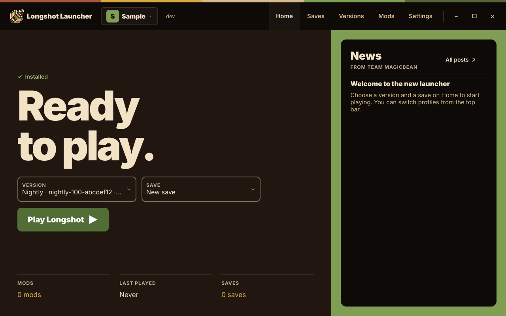

<h1 align="center">
  <br>
  Longshot Launcher
</h1>

<p align="center"><strong>Build and play Longshot on Windows and Linux, from your own copy of the game.</strong></p>

<p align="center">
  <a href="https://longshot.magicbean.dev/download"><strong>Download</strong></a> ·
  <a href="#install-and-play">Install and play</a> ·
  <a href="#updates-and-storage">Updates and storage</a> ·
  <a href="#development">Development</a> ·
  <a href="https://discord.gg/magicbean">Discord</a>
</p>



## Install and play

| Windows | Linux and Steam Deck |
| --- | --- |
| [Download the Windows launcher](https://longshot.magicbean.dev/download/launcher/windows) and open it. | [Download the AppImage](https://longshot.magicbean.dev/download/launcher/linux), make it executable, then open it. |

On first launch, choose **Install** to add Longshot to your account’s applications menu and use the usual data and cache locations. Choose **Run portable** to keep `Longshot/data` and `Longshot/cache` beside the download. On Linux, Install places the AppImage in `~/.local/share/longshot` (or `$XDG_DATA_HOME/longshot`). Move the whole portable `Longshot` folder with the executable when using portable mode. Its hidden `.portable` marker remembers the choice.

An in-place update keeps your install choice and starts from the same location. Opening a newer download on the same channel upgrades a recognized installed copy. Opening an equal or older download opens the installed copy. To switch tracks, use **Settings → Launcher**.

See [where Longshot keeps files](docs/paths.md) for the data, cache, portable and upgrade paths.

The downloads above follow the published stable release. This branch shows the Rust/Slint redesign. To try it from this checkout, follow [Development](#development).

1. Open the launcher and select your local `.nup` or `.nx` file, or an extracted game folder containing `romfs` and `exefs`. The launcher checks the copy you select.
2. Choose a game version and start the build. Allow about **15 GiB** for a first build with shaders. Later builds can reuse the tools, compiled code and shaders.
3. On **Home**, choose a version and a save, then select **Play Longshot**. You can leave setup and return from Home or Versions.

The launcher downloads the [Longshot builder](https://git.magicbean.dev/MagicBeanDev/Longshot). Your game files, generated game and saves stay on your PC.

## Inside the launcher

| Where | What you can do |
| --- | --- |
| **Profile menu** | Switch players or create a profile with its own saves, mods and game options. Installed versions are shared across profiles. |
| **Saves** | Choose where to continue, rename or duplicate a slot, or import and export saves. [Profiles and saves](docs/saves.md) |
| **Versions** | Add a separate installation, check all installations for updates, or change one installation’s optional upscaling modules. Updated modules take effect on its next launch. [Pull request builds](docs/pull-requests.md) |
| **Mods** | Import a local mod or browse the selected builder’s catalog. Review permissions before building with a new or changed ExeFS patch. Builders with limited mod support can still use extracted RomFS and ExeFS folders. |
| **Settings** | Choose data and cache locations, manage launcher updates, review logs, or add local figure dumps. [NFC tags](docs/nfc.md) |

You can navigate the launcher with a mouse, keyboard or controller. Gamepad hints appear along the bottom while you use a controller, including inside dialogs. [Controller navigation](docs/controller.md)

## Updates and storage

**Game updates** replace the installation you choose in Versions. **Launcher updates** follow the channel in **Settings → Launcher**. When an update is available, Home offers **View changelog** and **Update launcher**. Switching channels in Settings shows the installed and offered releases. Choose **Install and restart** to switch.

When upgrading from the previous stable launcher, compatible installations are imported and saves and mods are copied into profiles. Returning to stable opens the original files. Older stable releases understand the original portable layouts. To use one from a new `Longshot/.portable` setup, open an installed copy and switch its channel to Stable. [Moving from stable](docs/saves.md#moving-from-the-stable-launcher)

| Folder | What it holds | Fresh Linux default | Fresh Windows default |
| --- | --- | --- | --- |
| Longshot data | Profiles, saves, mods and installed versions, including their builders | `~/.local/share/longshot` | `%LOCALAPPDATA%\Longshot\data` |
| Cache | Downloaded tools, compiled objects and shared shader caches | `~/.cache/longshot` | `%LOCALAPPDATA%\Longshot\cache` |

Linux respects `XDG_DATA_HOME` and `XDG_CACHE_HOME`. Existing installations keep their populated or custom locations. Use **Settings → Game** to move a folder. In **Settings → Storage**, **Clean up** previews removable build files and their sizes, including eligible files from the previous launcher. Open **Previous launcher** to clean up individual categories.

## Development

The launcher is written in Rust with a Slint desktop interface. Install Rust and the platform libraries listed in the [CI guide](docs/ci.md), then run from the repository root.

```sh
cargo run --locked
```

Slint uses FemtoVG with OpenGL by default. Set `SLINT_BACKEND=winit-software` to use the CPU renderer, or `SLINT_DEBUG_PERFORMANCE=refresh_lazy,overlay` to display frame timing during interaction. Set `LONGSHOT_LAUNCHER_HOME` to use a separate launcher home for testing.

The executable also accepts `--self-check` to verify startup without opening a window, `--play` to start the selected build, and `--launch <folder>` to open the launcher with that installation selected.

| Source | Contents |
| --- | --- |
| [ui](ui) | Slint screens and shared controls |
| [src/game](src/game) | Release discovery, builder communication and launch |
| [src/players](src/players) | Profiles, saves and NFC |
| [src/update.rs](src/update.rs) · [src/update](src/update) | Launcher updates, package verification and rollback |
| [tests/update_handoff](tests/update_handoff) | Compatibility with the previous stable updater |

See [Contributing](CONTRIBUTING.md) for the test commands and PR workflow, [CI](docs/ci.md) for packaging checks and [Releasing](RELEASING.md) for the maintainer guide.

## License

Longshot Launcher is distributed under the [GNU General Public License, version 3 or later](LICENSE).
