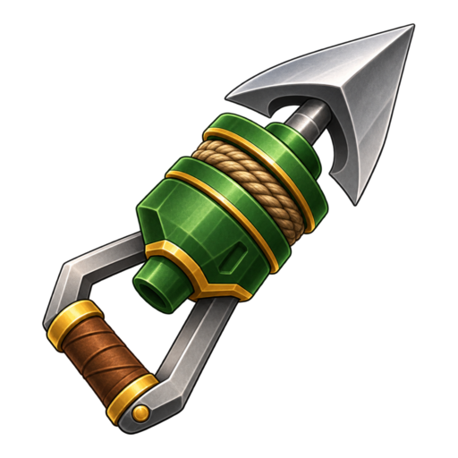
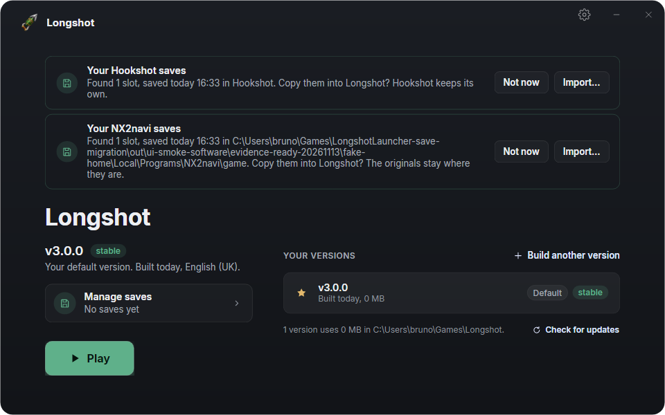
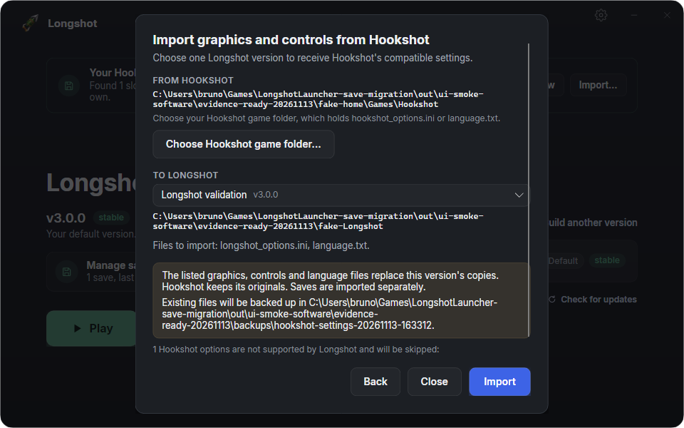

<h1 align="center">
  <br>
  <a href="https://git.magicbean.dev/MagicBeanDev/LongshotLauncher">
  
</a>

  <br>
  <b>Longshot Launcher</b>
  <br>
</h1>

<h4 align="center">Installs, builds, updates and starts <a href="https://git.magicbean.dev/MagicBeanDev/Longshot">Longshot</a>, which runs a supported console game natively on Windows & Linux.
</h4>


<p align="center">
  <a href="https://longshot.magicbean.dev/"><b>Website</b></a> |
  <a href="https://discord.gg/magicbean"><b>Discord</b></a> |
  <a href="#what-it-does">What it does</a> |
  <a href="#download">Download</a> |
  <a href="#installing">Installing</a> |
  <a href="#using-it">Using it</a> |
  <a href="#saves">Saves</a> |
  <a href="#updates-and-channels">Updates</a> |
  <a href="#build-from-source">Build from source</a> |
  <a href="#credits">Credits</a> |
  <a href="#license">License</a>
</p>

<p align="center">This website is our Git hosting, similar to GitHub.</p>

The Longshot Launcher is the one program players download to get [Longshot](https://git.magicbean.dev/MagicBeanDev/Longshot).
It installs Longshot's builder, builds the game **on your PC, from your own copy of the game**, starts it, and keeps
the game and itself up to date. It is a separate project from Longshot, with its own repository and its own releases.

<p align="center">
  
</p>

> [!NOTE]
> Nothing of the game is in the launcher or downloaded by it. It downloads Longshot's builder, which builds the game from
> the copy you own. Don't ask where to get the game.

Discord: https://discord.gg/magicbean

## What it does

| | |
|---|---|
| **Builds the game** | A three-step wizard: it finds your game files while that version's builder downloads, then the settings (DLSS, FSR 4, Intel XeSS, language, the builds folder), then the build with one progress bar |
| **Several versions side by side** | Keep a stable build and a nightly; Play starts the default one; Set as default, Saves, Open folder and Delete for each |
| **Two channels** | `stable` and `nightly`, chosen per build and, apart from that, for the launcher itself |
| **Installs Longshot's builder** | For each version, from Longshot's signed release: every file checked against its SHA-256 before it is used |
| **Updates the game** | Offers each build its channel's newest version and builds it from the game files the build kept |
| **Updates itself** | From its own signed releases, checked and tested before it replaces itself; `--rollback` puts the previous one back |
| **Saves** | One save folder for every build, imports saves from emulators and from Hookshot, exports them to emulators, and to and from one .zip file; a Progress view per slot shows what a save has and is missing and edits it, with a backup first; and it restores the backups every copy makes ([docs/saves.md](docs/saves.md)) |
| **Pull requests** | The *Pull request* track builds an open Longshot pull request on your PC to help test it: the ones a BigBean wrote or approved are listed, any other found by its number, with warnings before its code is built; it updates with each push ([docs/pull-requests.md](docs/pull-requests.md)) |
| **Controller and TV** | The whole launcher with a controller (the d-pad or stick moves, A presses, B goes back), and in Steam's Gaming Mode or Big Picture a full-screen view for the TV ([docs/controller.md](docs/controller.md)) |
| **NFC** | Keeps the NFC tag dumps of figures you own, which the game's NFC tab lists: add one, many or a folder of them, scan one with a Switch 2 Pro Controller (Windows), delete them ([docs/nfc.md](docs/nfc.md)) |

## Download

# ⬇️ Download Longshot Launcher

### [🪟 &nbsp;Download for Windows](https://longshot.magicbean.dev/download/launcher/windows)

### [🐧 &nbsp;Download for Linux (AppImage)](https://longshot.magicbean.dev/download/launcher/linux)

Windows without installing: [portable zip](https://longshot.magicbean.dev/download/launcher/windows-portable) · Not sure? [longshot.magicbean.dev/download](https://longshot.magicbean.dev/download) picks for your computer.

These links always give the newest launcher: the stable one, or until there is one, the nightly. To pick a channel:

- **Stable** (for playing): [Windows](https://longshot.magicbean.dev/download/launcher/stable/windows) · [portable zip](https://longshot.magicbean.dev/download/launcher/stable/windows-portable) · [Linux](https://longshot.magicbean.dev/download/launcher/stable/linux) · [release page](https://longshot.magicbean.dev/download/launcher/stable)
- **Nightly** (every change, untested): [Windows](https://longshot.magicbean.dev/download/launcher/nightly/windows) · [portable zip](https://longshot.magicbean.dev/download/launcher/nightly/windows-portable) · [Linux](https://longshot.magicbean.dev/download/launcher/nightly/linux) · [release page](https://longshot.magicbean.dev/download/launcher/nightly)

Every release is on [the releases page](https://git.magicbean.dev/MagicBeanDev/LongshotLauncher/releases). The files:

- **Windows 10 and 11 (x64):** `LongshotLauncher-<version>-windows-x64-setup.exe`. Start it, then choose *Install* or
  *Run portable* ([Installing](#installing)).
- **Windows, portable:** `LongshotLauncher-<version>-windows-x64-portable.zip`. Unzip it anywhere (a USB stick) and start
  `LongshotLauncher.exe`.
- **Linux and Steam Deck (x86-64):** `LongshotLauncher-<version>-x86_64.AppImage`. Make it executable (`chmod +x`) and
  start it.

This is the one download: the launcher installs Longshot's builder for you. The builder files on
[Longshot's releases](https://git.magicbean.dev/MagicBeanDev/Longshot/releases) are for the launcher, not for you.

All of them are in the release's signed `SHA256SUMS`. After that the launcher updates itself. Its numbers are its own:
Longshot's start at v3.0.0, the launcher's at v1.0.0.

> [!TIP]
> Windows may warn about an unknown program on its first start (the program is not code-signed yet). Choose *More info*,
> then *Run anyway*.

## Installing

There is no installer program: the launcher installs itself.

**Windows.** The first start of the setup file asks:

- **Install** copies it to `%LOCALAPPDATA%\Programs\LongshotLauncher\LongshotLauncher.exe` (for your user only, no
  administrator rights), adds a *Longshot Launcher* shortcut to the Start menu and an entry in *Apps & features*
  (publisher Magic Bean), then starts the installed copy. After each of its own updates it makes the Start menu shortcut
  (and the *Longshot* shortcuts it made) again, so they start the updated program. Its data goes in `%LOCALAPPDATA%\LongshotLauncher`. You can
  delete the setup file afterwards. `LongshotLauncher-<v>-windows-x64-setup.exe --install` does the same without asking.
  A setup file older than the launcher installed (which has updated itself since) never goes back over it: it starts the
  installed launcher instead.
- **Run portable** puts a file named `portable` beside the program, and from then on the launcher keeps everything in a
  `LongshotLauncher-data` folder beside it: its settings, its list of builds, the builder's tools, the build files, and by
  default the builds and the save backups too. It never writes the registry, and makes no shortcut unless you tick one
  when a build is ready. The portable
  zip has the `portable` file in it already, so it never asks.
- **Switching between them.** An installed launcher and a portable one each keep their own list of builds and (on Windows)
  their own saves. A portable launcher that starts with no build offers the installed launcher's builds and saves on this
  PC: its builds are listed where they are, and its saves are copied in if the portable launcher has none yet. The other way,
  *Add a build folder…* on the home takes a game folder, a folder of them, or a portable launcher's `LongshotLauncher-data`
  (its builds, and its saves where there are none yet). A save is never copied over another: *Manage saves* imports one, after a
  backup.

**Uninstalling** (Windows): *Settings > Apps > Installed apps > Longshot Launcher > Uninstall*, which runs
`LongshotLauncher.exe --uninstall`. It removes the program, its Start menu shortcut, the *Longshot* shortcuts it made, and
its *Apps & features* entry. It asks whether to delete its data too; your builds' game folders and your saves are never
deleted, even when they are inside it.

**Updates keep the kind.** An installed launcher updates its installed `LongshotLauncher.exe`, from the release's setup
file; a portable one takes `LongshotLauncher.exe` out of the release's portable zip and updates itself in place, beside its
`portable` file. Either way the file keeps the name it was installed or started as.

**Linux and the Steam Deck.** The AppImage needs no installing. *Settings > Applications menu > Add to applications menu*
writes `~/.local/share/applications/longshot-launcher.desktop` and its icon, starting the AppImage where it is now; add it
again after moving the AppImage, or *Remove* it. **Portable on Linux** is the AppImage convention: make a folder named after
the AppImage with `.home` added (`LongshotLauncher-v1.0.0-x86_64.AppImage.home`) beside it, and the launcher keeps its data
there. (The AppImage runtime then also points `$HOME` there, for everything the launcher starts.)

**One launcher at a time.** A second start of the launcher brings the open one's window forward instead (one per data
folder: a portable launcher and an installed one can run side by side).

**If an update was cut short on Windows** (the PC lost power during the swap), the launcher puts the earlier one back the
next time it starts. If `LongshotLauncher.exe` itself is missing, rename `LongshotLauncher.exe.old` beside it back to
`LongshotLauncher.exe`.

## Using it

1. **Build another version** (or, the first time, **Build the game**) opens the wizard. Pick the channel: *Stable* for
   playing, *Nightly* for the newest changes.
2. **Game files**: the launcher looks for your dump on this PC; point it at the folder if it doesn't find it.
3. **Settings**: the builds folder (Settings' own: Change sets it for every build; this build goes in
   `<builds>/<track>/<version>`, shown under it), the language, and DLSS, FSR 4 or, on Windows, Intel XeSS (their licences are shown
   first; with XeSS on, the build downloads Intel's XeSS library for the game's Upscaler row). A red line warns when the
   launcher's estimated Auto GPU cannot run DLSS or FSR 4; if the estimate is unavailable, it checks all display adapters.
   The estimate can differ from the game, for example when a laptop has a per-executable graphics preference. The switch still
   turns on: the build fetches its files for tools like OptiScaler. XeSS
   is never red: it runs on other makers' cards too where their driver has what it needs, which the game checks at its
   start. Your saves come
   along: every build shares them. On Windows with Intel graphics, **Intel shader compiles** chooses how many shaders
   Intel's driver is given at once, for the build and the game: *Auto* (recommended: the game's own choice, side by side
   on the Arc B-series and one at a time on other Intel graphics, and the game's Intel shader compiles row stays free to
   change), *Side by side* (faster on a CPU with many cores, but can crash Intel's driver) or *One at a time*. Side by side
   and One at a time hold the game's row at that value. **Shader time limit** on *Longer* waits up to 30
   minutes, not 5, on a driver that seems stuck before the shader preparation gives up, and 3 minutes, not 30 seconds,
   for the last pipelines: for a slow Intel GPU whose build says the GPU driver stopped responding.
4. **Build**: about 15 to 30 minutes the first time, shaders included. An update compiles only what changed.
5. **Play**. Ready can also make desktop and menu shortcuts, which start the default version.

The cog on the home opens the launcher's settings: the **launcher's language**, the channel for new builds, the
**launcher's own channel**, the builds folder (your instances, one folder per track and version; its folder button opens
it in the file manager), the build files folder (working files every build reuses, not the game; and *Free up space*; by
default `~/.cache/longshot/launcher/work` on Linux, `%LOCALAPPDATA%\LongshotLauncher\work` on Windows),
the update check at start, and on
Linux the launcher's entry in the applications menu.

The launcher speaks the game's sixteen languages. It starts in the system's (Windows' display language; on Linux `LANGUAGE`,
`LC_ALL`, `LC_MESSAGES` or `LANG`), else English, until one is picked in Settings, and a pick changes the window at once. The
game's own language is apart from it: a build setting (step 2), as before.

<p align="center">
  
</p>

### With a controller, on a TV

The d-pad or left stick moves between the buttons, **A** presses one, **B** goes back (Back, Cancel, Keep or Done), the
bumpers step through every control in turn and the right stick scrolls. Started from Steam's **Gaming Mode** (a Steam
Deck, a ROG Ally on Bazzite) or **Big Picture**, the launcher fills the screen for the TV; **F11** does it anywhere. All
of it: [docs/controller.md](docs/controller.md).

## Saves

Every build shares one save folder (`%APPDATA%\Longshot` on Windows, `~/.local/share/longshot/user` on Linux, or
`~/.local/share/longshot` itself for builds from before it: [docs/saves.md](docs/saves.md#where-longshot-keeps-them)). On Windows the
launcher brings in, once, the saves each build kept in its own folder before, and the 2.x Builder's, keeping the newest
after backing them all up ([docs/saves.md](docs/saves.md#saves-from-before-windows)). The **Saves** page imports saves from
Lichii, Eden, NX2navi and the other emulators, and exports them back, or the whole save folder into one .zip file to
keep or send, which it imports again after checking it is safe. You can import before playing Longshot for the first time. Every copy
backs up what it replaces first, and *Restore from a backup…* lists those backups and puts one back. *Open saves folder*
shows the save folder in the file manager, to find the saves by hand.

**Coming from NX2navi?** The home offers to import saves found in its usual game folder. Choose the profile and confirm
the import; the originals stay where they are. Portable or custom installs can be chosen by hand.

**Coming from Hookshot?** The launcher finds Hookshot's saves and offers once to copy them in, or use
*Saves > Import from Hookshot…*. It copies them and never moves them, so Hookshot keeps its own. It checks the files
first, and it asks, and backs up, before it replaces a Longshot save. **Import graphics and controls…** separately brings
compatible Hookshot game settings into the Longshot version you choose, with its own confirmation and backup.

<p align="center">
  
  
</p>

**Finishing a save?** *Saves > Progress* on a slot lists what it has and what is missing, by name and area, and sets or
takes away a group, gives items, hearts, rupees or keys, sets where Link starts and copies a slot. It runs Longshot's own save
editor from your build's tools, backs the save up first, and refuses while the game runs
([docs/saves.md](docs/saves.md#progress-and-edits)).

All of it, with where every save lives: [docs/saves.md](docs/saves.md). Longshot's own
[saves guide](https://git.magicbean.dev/MagicBeanDev/Longshot/src/branch/main/docs/saves.md) has the same from the command
line (`scripts/longshot_saves.py import|export`).

### NFC

The **NFC** page (the *NFC* card on the home, under *Manage saves*) keeps the NFC tag dumps of figures you own: `.bin`
(a raw NTAG215 dump) and `.nfc` (Flipper Zero) files, in one folder every build of the game shares. Add one file, many,
or a whole folder; each is checked first, and a file that is not a dump is skipped and named. Delete one or several, or
open the folder. In the game, the Insert menu's NFC tab lists them by file name. Nothing of a dump leaves your PC. All of
it: [docs/nfc.md](docs/nfc.md).

**Scan a tag…** (Windows) reads a tag with a Nintendo Switch 2 Pro Controller plugged in over USB and saves it there as
`Scanned <UID>.bin`. Close Steam, the game and any controller bridge first: only one program can hold the controller. Scan
only tags you own. The tag is only read, never written.

## Updates and channels

Longshot and the launcher are released apart, from their own repositories, each on three channels:

| Channel | Made from | For |
|---|---|---|
| `stable` | a tag `vX.Y.Z` | playing |
| `nightly` | every change to `main` | the newest changes, untested |

**Two choices in Settings.** *Channel for new builds* is the channel of Longshot a new build follows (each build keeps
its own). Until you pick one, it follows the launcher's channel: a nightly launcher builds nightlies. *Launcher updates* is the channel the launcher updates **itself** from: LongshotLauncher's own stable or
nightly, apart from any build's. It starts on the channel of the launcher you installed.

Every release's `SHA256SUMS` is signed with the release key, which the launcher has built in. The launcher installs nothing
whose signature or SHA-256 does not check out, and never goes to a lower version by itself. A new launcher is downloaded
beside the current one and checked. It is then started once with `--self-check`, and only then swapped in.
`--rollback` puts the previous launcher back. How releases are made and checked: [docs/releases.md](docs/releases.md);
how to make one: [RELEASING.md](RELEASING.md).

## Build from source

The [.NET 10 SDK](https://dotnet.microsoft.com/download), on Windows or Linux:

```sh
git clone --depth 1 https://git.magicbean.dev/MagicBeanDev/LongshotLauncher.git
cd LongshotLauncher
dotnet build LongshotLauncher.slnx
dotnet run --project App
```

`scripts/package.sh <tag> <out folder>` makes the two release programs on Linux (a test build unless CI signs it).

### Layout

| | |
|---|---|
| `Core/` | `LongshotLauncher.Core`: the logic, no UI and no package. Versions and channels (`Versions`), the signed releases of Longshot and of the launcher (`Releases`, `ReleaseTrust`, `ReleaseManifest`), its own update (`SelfUpdate`), each version's builder and its tools.lock (`Toolchains`, `ToolsSource`, `ToolsLock`), game folders, `builds.json` (`BuildRegistry`), remembered settings, make_game.py's command line, `@@` lines, run and check (`MakeGameCommand`, `MakeGameProtocol`, `MakeGameRun`), the game files found on this PC (`GameFiles`), update offers (`UpdatePolicy`), saves (`Saves`, a port of Longshot's `scripts/longshot_saves.py`; `SaveText`) and Hookshot's (`HookshotSaves`), the NFC tag dumps the game reads (`NfcTags`) and scanning one with a Switch 2 Pro Controller (`NfcReader`), the save editor Progress runs from a build's tools (`SaveEditing`, `SaveEditorReport`), the game settings brought to a new build (`SettingsCarry`), disk space (`Disk`), this PC (`SystemInfo`), shortcuts (`Shortcuts`), installed or portable (`LauncherLayout`, `Installer`), one launcher per home (`InstanceLock`), a controller's presses and the TV view (`Gamepad`, `GamepadReaders`), the launcher's home and command line |
| `Core/Lang/` | The launcher's translations, one catalog per language (`Tr`, [Translations](#translations)) |
| `App/` | `LongshotLauncher`: the Avalonia window. `ViewModels/` (one per page and dialog), `Views/` (one .axaml each, compiled bindings), `Controls/` (icons, bars and spinner), `PadInput.cs` (a controller), `App.axaml` (the palette and the styles), `Assets/` (the Longshot logo and icon, the Inter font with its licence) |
| `tools/screenshots/` | The screens drawn without a display into PNGs ([Screenshots](#screenshots)) |
| `tests/` | `test_launcher_core.py` (builds `launcher_core/`, which compiles `Core/` and checks it), `fixtures/` (signed test releases, fake Hookshot saves, what Longshot's save editor answers as JSON), `save_editor_fixtures.py` (checks that text against a Longshot checkout) |
| `scripts/` | `package.sh` (both release programs, from Linux), `make_icon.py` (`App/Assets/longshot.ico` from the logo), `translations.py` (the window's texts against each catalog) |
| `.forgejo/workflows/` | `ci.yml` (compile and test, every pull request), `release.yml` (the nightly from `main`, a release from a `v*` tag) |
| `docs/` | [releases.md](docs/releases.md), [saves.md](docs/saves.md), [nfc.md](docs/nfc.md), [controller.md](docs/controller.md), and the screenshots in this README |

### Screenshots

`tools/screenshots` draws the launcher's screens without a display (Avalonia.Headless, rendered by Skia), each in a launcher
of its own: a home in a temporary folder, a player's folders as the screens show them, no game files and no network. For
a pull request that changes a screen:

```sh
dotnet run --project tools/screenshots -- work/screenshots            # every scene
dotnet run --project tools/screenshots -- work/screenshots build-log  # only these
```

Each scene is one PNG of the 960x600 window, named after it; the scenes are in `tools/screenshots/Program.cs` (the home,
the build settings on Linux and Windows, on Windows with a card that runs neither DLSS nor FSR 4, and with Intel graphics, the FSR 4 notice, Intel's XeSS licence, the build page with and
without its details). A change to a
screen adds or updates the scene that shows it.

### Environment and command line

| | |
|---|---|
| `LONGSHOT_NFC_DIR=<folder>` | The NFC folder somewhere else (a full path), for the game and the launcher alike: the launcher passes it on to the game it starts, on Linux too, where it drops its other `LONGSHOT_` variables ([docs/nfc.md](docs/nfc.md)) |
| `LONGSHOT_LAUNCHER_DEBUG_SLOW=<ms>` | A Debug build only: waits that long before each answer from git.magicbean.dev and a tenth of it after each MB downloaded, to see the busy states (the launcher's update, the check, the tools' download) |
| `LONGSHOT_LAUNCHER_EXE=<path>` | What the shortcuts and the game folders (`builder=`) start this launcher with, for a package whose own path is only inside it (the Flatpak sets it). A launcher not started from its own file (the Flatpak's, `dotnet run`) is not offered its own updates |
| `LONGSHOT_LAUNCHER_HOME=<folder>` | The launcher's home (`builds.json`, `settings.json`, `toolchains/`, `logs/`) somewhere else, for trying it out; the build files (`work/`) and the SDKs a build fetches go in it too, not in `~/.cache` |
| `LONGSHOT_LAUNCHER_NO_CDN=1` | Every release list, release file and build tool from git.magicbean.dev itself, not through `git-cdn.magicbean.dev` (Cloudflare's cache of the same files and lists, tried first otherwise; a list there may be a minute old, and is still answered while git.magicbean.dev is down; the rest of the API is always git.magicbean.dev's). A file asked of git.magicbean.dev, here or after the CDN failed, has `cdn=0` in its link, without which the server redirects it to `git-cdn.magicbean.dev` |
| `LONGSHOT_LAUNCHER_NO_PREFETCH=1` | The build tools download only in a build's first step. Otherwise, with no builds yet, the newest version's tools on your channel start downloading as soon as the update check answers; an update's too, only when Settings' "Download the build tools of an update as soon as it is out" is on (off at first) |
| `LONGSHOT_LAUNCHER_OFFLINE=1` | No update check |
| `LONGSHOT_LAUNCHER_TV=1` | The TV view (full screen, scaled up, square corners) anywhere; `=0` never, even in Steam's Gaming Mode or Big Picture ([docs/controller.md](docs/controller.md)) |
| `LONGSHOT_LAUNCHER_TRUST=<public key .pem>` | Trust one more release key, for a release signed with a test key |
| `--launch <folder>` | Opens on that build |
| `--play [<folder>]` | Starts the game with no window (the shortcuts use it) |
| `--self-check` | Prints `LongshotLauncher <version>` (a new launcher answers it before it is put in place) |
| `--rollback` | Puts back the launcher the last update replaced |
| `--install` | Windows: installs this launcher without asking ([Installing](#installing)), then starts the installed copy |
| `--uninstall` | Windows: uninstalls the installed launcher (what *Apps & features* runs); it asks about the data first |

### Tests

```sh
python -I tests/test_launcher_core.py [--longshot <checkout of Longshot>]
LAUNCHER=$PWD python -I ../Tooling/tests/test_release.py
```

The first builds `tests/launcher_core`, which compiles the core with no package and checks it with no game, no network
and no window. It covers the version order, the signed releases (signatures, channels, products, replays, hashes, against
files Tooling's `release.py` signed with a test key), the launcher's own update (download, self-check, swap, rollback, the
recovery from a swap cut short, the portable zip), install, uninstall and the portable layouts (with a fake registry and fake
shortcuts: the tests never touch the real ones), one launcher per home, a download that stalls, a save copy that fails half
way, the
saves against Longshot's `tests/test_longshot_saves.py` cases, the Hookshot import against fake saves, the NFC folder against fake tags made in the test, a tag scan against a fake controller, and the rest over
temporary folders. With `--longshot`, it also checks the languages and the DLSS, FSR 4 and XeSS licence texts against
Longshot's `make_game.py` and `scripts/fetch.py` (before Longshot #1802: `ngx_sdk.py`, `ffx_sdk.py` and `xess_sdk.py`, XeSS's
when that Longshot has it), and that a Longshot whose `make_game.py` fetches XeSS carries the script the launcher looks for. The second checks Tooling's `release.py` with keys it makes (it needs the
`openssl` command line). CI runs both and compiles with warnings as errors. Contributing: [CONTRIBUTING.md](CONTRIBUTING.md).

### Translations

Every text the window shows is written in English in the sources, as `Tr.T("...")` (with parts, `Tr.F("... {0}", x)`; a
count, `Tr.P(n, "1 slot", "{0} slots")`) in the C# and `{c:T '...'}` in the views. `Core/Lang/<code>.json` maps each English
text to its translation, a count's entry to its forms by CLDR plural category (`one`, `few`, `many`, `other`: the categories
the language has). A text missing from a catalog shows in English. `en-GB`, `fr-CA` and `es-419` hold only what differs from
English, French and Spanish; the others hold every text.

```sh
python -I scripts/translations.py                 # what each catalog lacks or has left over, and broken placeholders
python -I scripts/translations.py --missing de    # the texts de.json lacks, as JSON to fill in
```

`tests/test_launcher_core.py` runs the same check: a broken placeholder, a wrong set of plural forms or a catalog entry no
source has any more (a changed English text) fails it; a text a catalog lacks is only said. A native speaker's fix to a
catalog is welcome as a pull request. Logs and *Copy for a bug report* stay in English.

### Planned next

- **Profiles and a clean folder layout**: builds in `~/Games/Longshot/versions/<version>` and the player's saves and
  settings in `~/Games/Longshot/profiles`. Until then, new builds go to `~/Games/Longshot/<channel>`, and Delete refuses
  a folder that holds another build.
- **Authenticode** for the Windows program.
- An update check before `--play` (the shortcuts start the game without one).

## Design decisions

Calls made here, most of them the design mockup's; each can be changed:

- **On Linux, the data folder holds only what cannot be made again.** `~/.local/share/longshot/launcher` keeps the
  settings, the list of builds, the logs and the versions' tools (`toolchains/`: a build is played, updated and reported
  with its version's, 0.5 to 3 GB to download again, and an old version's may be gone); the build files (`work/`) and the
  SDKs a build fetches (`ngx-sdk/`, `xess-sdk/`, `ffx-sdk/`) are in `~/.cache/longshot/launcher` (`$XDG_CACHE_HOME`;
  `LauncherHome.Cache`). A launcher from before kept them in its home: the first start that holds the home moves each with
  one rename (`LauncherHome.MoveToCache`), never a copy; one on another disk stays and is used where it is, and a build
  files folder you chose stays yours. Without them a build is slower, never wrong. On Windows `%LOCALAPPDATA%` is not
  roamed already, so they stay in `%LOCALAPPDATA%\LongshotLauncher`; a portable launcher and `LONGSHOT_LAUNCHER_HOME`
  keep everything in their one folder.
- **One folder of save backups.** New backups go to `save-backups` (`SaveEnvironment.BackupRoot`); the folders of before
  (`oot-save-backups`, Linux's `longshot/save-backup`) are listed and restored from, never written, moved or emptied
  (`SaveEnvironment.OldBackupRoots`).

- **One save folder for every build.** The launcher starts each build with `--user %APPDATA%\Longshot` on Windows and
  `--user ~/.local/share/longshot` on Linux (`GamePlay.UserFolder`; not on Linux while the build's folder has a `user/` of
  its own, which the game takes in itself), so an update or a new build starts where you left off. The same `--user` for
  every version: on Linux a newer game keeps its files in that folder's `user/`, moving them there itself at its first
  start, an older one in the folder itself, and the launcher reads whichever the game uses (`SaveEnvironment.LongshotUser`:
  `user/` once it is there; `LongshotRoot` is the folder passed). The saves builds kept in
  their own folders before are brought in once (`Saves.Gather`): the one with the newest progress is kept, all of them
  backed up, the old ones renamed aside and never deleted. Where one was, `user\save` becomes a link (a junction) to the shared
  save, and `Saves.LinkSaves` makes the same link in a build that has none, so a build started on its own on Windows (no
  `--user`) reads and writes the shared saves, and the next start has nothing to take in again (Longshot#639).
- **The game settings follow too.** A Longshot that takes `--user` for them keeps `longshot_options.ini` in that folder.
  Before Play, a build whose own file holds no setting (a new build: `compile_shaders=` alone) is filled
  from the newest of the user folder's and the other builds' files, its `compile_shaders=` kept (`SettingsCarry`), so a
  build from before that change keeps the player's settings as well. The launcher never writes the user folder's file.
- **So do the program's own settings in Windows and NVIDIA's driver** (Windows). Both are kept by the program's full path,
  which a new build's folder changes. Before Play, a build's program with none of its own gets the most recently updated other
  build's (`DriverSettings`): its graphics preference (`HKCU\Software\Microsoft\DirectX\UserGpuPreferences`, which GPU it
  runs on), and the NVIDIA program profile that names the old program by its path (the NVIDIA app's or Control Panel's
  program settings, such as Smooth Motion), which the new program joins through NVAPI. Nothing is taken away; a refusal
  leaves things as they were.
- **Instances live in `<builds>/<track>/<version>`**: `<builds>/nightly/nightly-2029-c544828f`, `<builds>/stable/v3.0.1`
  (`LauncherSettings.FolderFor`; the version's own name, safe for a folder on Windows and Linux; `Longshot` for a track
  or a version with no such name). A second instance of the same version is `<version> (2)`, the only time a suffix
  appears. The builds folder is one setting, Settings' and step 2's (its Change in step 2 changes it in Settings too), so
  a folder always says what is in it, and a player cleaning up their disk sees which version is where.
- **An update renames its instance's folder.** An update or a go-back builds in the folder its instance has, renamed to
  the new version's name when the build starts, before make_game.py (`BuildRegistry.FolderOf`, `InstanceFolders.Rename`):
  `nightly/nightly-171-…` becomes `nightly/nightly-175-…`. A rename, not a copy: the game, its settings, mods, shader
  caches and a save in its own `user/save` go with it, and no folder of the version before is left on the disk. The row
  takes the new folder at once (saved), then the new version when the build finishes (`BuildRegistry.Replace`). Step 2
  says it: *`<old>` becomes `<new>` when the build starts*. The launcher's own shortcuts start `--play` and keep working;
  **a shortcut or a Steam entry made to the game's own program (`bin/longshot.exe`) points at the old path and has to be
  made again after an update** (the price of a folder that names its version). A rename is refused, and nothing changes
  or starts, while Longshot runs, onto a path that is there, and on Windows while a file in the folder is held open (a
  File Explorer window in it, an editor, an antivirus scan): the problem page says why and Build again tries again. A
  build that fails or is stopped renames the folder back (`InstanceFolders.MoveBack`, waiting up to 10 s for a file the
  stopped build still holds), so the row's folder names the version the row still has. An instance in a folder the player
  chose before (outside the builds folder's layout) is never renamed. So an update replaces the version before it, and
  the way back is to build that version again: pick it in the home's **Version** dropdown (below), which lists its
  track's releases the server still has (every release, the newest 5 nightlies: `VersionPick`),
  and the button builds it the same way, as "Go back to". Update then offers the newest again. Your saves stay: every
  build shares them. make_game.py puts the new files in only once they are complete, so a build that stops leaves the old
  game playable. It does not start while Longshot runs: Save and close it first. On Windows, Longshot started during the
  build stops it at its last step, which then asks to close it and build again (what was built is kept).
- **Old versions' folders.** Before an update stayed in its build's folder (#104), every update left a folder named after
  a version, no longer in the list of versions. **The home offers to delete them** (*Old versions left on the disk*: Keep
  or Delete; `Leftovers`): the game folders in the builds folder and in its tracks' folders (`InstanceFolders.Folders`)
  that no build lists, once nothing of the player's is in them (no save left in `user/save`, which `Saves.Gather` takes in
  first on Windows; neither `user/` nor `user/save` a link, but the launcher's own to the shared save; nothing in `mods/`),
  and never one that holds a build's folder or the launcher's home. It says what deleting them frees (their files with no hard link outside them), deletes nothing
  while Longshot runs, and Keep is remembered (`KeptFolders` in settings.json).
- **Instances from before this layout move into it when the player says so.** They are right in the builds folder,
  named after their track (`nightly`, `nightly (2)`: launchers v1.0.0-rc.7 and on) or after the version they were first
  built with (`v3.0.0-rc.5`: launchers before). **The home offers to move them** (*Instances in the old folder layout*:
  Keep or Move; `InstanceFolders.Plan`): each to `<builds>/<track>/<version>` past every name taken, the ones named after
  their track first, since `<builds>/nightly` becomes the nightly's folder (moved by way of a name beside it). Nothing is
  moved unless the player says so, and the same rules as an update's rename hold: everything in the folder goes with it,
  the launcher's shortcuts follow, refused while Longshot runs, for a link, a folder that holds the home folder or
  Longshot's shared saves, a name taken since, or a folder that would go inside another instance's; the list is saved
  with the new folder, or the folder goes back. Until then a new instance never goes inside an old one's folder named
  after its track (`<builds>/nightly (2)/<version>` instead). A folder elsewhere, which the player chose, is never
  offered. Keep is remembered (`KeptFolderNames` in settings.json).
- **An update keeps the shader caches.** The game keeps its translated shaders and pipelines in its folder's `cache/`
  (10 GB and minutes of preparing), good for one shader translator. An update in its build's folder keeps them where they
  are, a rename to its new version's name included (the same folder); the game drops them itself when its translator
  stamp differs. An update built in another folder starts with none there. When the old and the new version's tools stamp the translator the same way
  (`ShaderCaches.Translator`, Longshot's `nx2/translator_files.py`) and compile it with the same tools
  (`ShaderCaches.Compiler`: the SHA-256 of `tools.lock`'s llvm-mingw and cpm on Windows; of emsdk, the sysroot and cpm
  on Linux), the update takes the old build's caches into the new folder before make_game.py starts (`ShaderCaches.Keep`).
  make_game.py keeps a `cache/` it finds in its folder, as a rebuild keeps its own, so the build's Prepare shaders step
  (every build runs it) finds them and has little left to do; after the build it would already have made caches of its
  own there. On the same drive these caches are moved, except for the pipeline notes (`longshot_pipelines.bin`), which
  make_game.py writes over and which are copied to preserve the old build's notes. When the translators differ, their
  tools are missing, or there are no translated programs, the driver's pipeline cache, its stamp, base and play files,
  and the notes alone are copied, if the driver cache exists. This keeps the old build's cache intact if the target game
  discards or changes it. Copies also serve a new folder on another drive and require room for the build beside them.
  A build that fails or is stopped puts moved caches back and removes copies (`ShaderCaches.Undo`), so the build still
  listed keeps its caches. Transfer is skipped when the new folder has caches already, while the game runs, or without
  room for a copy; it also cannot carry the pipeline side without a driver's cache. What the game adds to the stamp itself (the GPU, its switches) the launcher cannot
  see: if that differs too, the game drops them and prepares again.
- **The Track and Version dropdowns** on the left of the home pick what to play or build (`VersionPick`). Track is stable,
  nightly or a pull request, each saying what is installed on it; Version lists that track's versions the server has (and installed
  ones it no longer lists), a check beside each installed one, the default and the newest marked. Before the update check
  answers, only the installed versions are there. The button below follows the pick: **Play** when that version is
  installed (Update beside it when its track has a newer one, and Remove: the row's Delete); **Update to** or **Go back
  to** when the track has a build of another version, built in its place, in its folder (one build per track); **Build**
  when the track has none, into a folder of its own. A line under it says which. The home opens on the default build, and
  selecting a row puts the dropdowns on it; with several builds on one track (Build another version beside it:
  `nightly (2)`), a pick replaces the row selected, else the track's default, else its last built.
- **Building a version you already have is a rebuild** of that build, in its folder ("Rebuild vX" in the channel picker).
- **Play from a row's actions**: selecting a version shows Play this version, Set as default, Saves, Open folder and
  Delete, and puts the dropdowns on it. Set as default puts them on it too.
- **Deleting the default** makes a release build the default when one is left, else the first.
- **Delete takes the folder**: only a game folder make_game.py made, and never a link, the home folder, or a folder that
  holds another build or the launcher's home; not while Longshot runs. On Windows it warns that the build's saves go with
  it.
- **Switching versions reuses the earlier builds' work.** Every build turns on Longshot's object store and lift store
  (`LONGSHOT_OBJ_STORE`, `LONGSHOT_LIFT_STORE`) in the build files folder, `obj-store` and `lift-store`, so they are on
  its drive whichever folder the player chose (the objects are hard links into `objcache`, copies only on a file system
  without hard links: exFAT, FAT, some network shares). Going between stable and nightly, or back to a version built
  before, then compiles only what no earlier build compiled and copies the translation instead of making it again. The
  first switch back to a version may still translate again: the lift store's key hashes the build files folder's
  `chunks.txt` and `hot_pieces.txt` as they are, which the other version's build has rewritten. What they cost: an object
  a build still uses is one file with `objcache` (where it is hard-linked), the others go after 14 days and the oldest
  first above 4 GB (`LONGSHOT_OBJ_STORE_GB=4`, Longshot's default is 8); a kept translation is about 1.6 GB, its lifted C
  whole, and two are kept (`LONGSHOT_LIFT_STORE_KEEP=2`, Longshot's is 3). The stores came with Longshot v3.0.0-rc.4 and
  nightly-164; tools from before them ignore the variables.
- **Free up space** (the launcher's settings) lets go of what make_game made in the build files folder (`objcache`, `sa`,
  `exefs`, `probe`, as the 2.x Builder, and the two stores), never the folder itself, which the player may have chosen.
  It asks first, listing each part in plain words with its size and what it was kept for (`Disk.WorkGroups`), and what the
  next build then costs. It can clear the versions' shader caches too, unticked by default (`ShaderCaches.Clear`): each
  game folder's `cache/` files the game reads back, never anything else there, never while Longshot runs, and never the
  pipeline notes (`longshot_pipelines.bin`), which hold the list the build shipped and only a build writes again. Each
  version then prepares its shaders again at its next start. The settings say what is kept and why, with the shader
  caches' size beside the build files'.
- **A completely cold build** (step 2's Advanced, for that build only; the problem page after a failed build offers it as
  *Try a completely cold build*, which opens step 2 with it ticked) uses nothing earlier builds kept: before make_game.py
  starts it deletes the build files and both stores, and the build's folder's shader caches with their pipeline notes
  (`ColdBuild.Clear`; make_game.py writes the notes again). It takes no caches from the build it replaces and no game
  files from another build (`LONGSHOT_ROMFS_FROM`), so the .nup is read again. It takes as long as a first build, and
  switching to another version afterwards builds slower, its stores gone. Never while Longshot runs; saves, settings
  and mods stay. The bug report's settings line says `cold build`.
- **The shortcuts** Ready makes (desktop, Start menu / applications menu), ticked by default and made as Ready shows,
  start `--play`, the default build, so they follow "Play starts this version" and updates. A portable launcher's ticks
  start as the shortcuts that start it already are, and it makes or removes them only when ticked; it never writes over
  or removes a shortcut that starts another launcher, nor does a Windows launcher that is not installed
  (`Shortcuts.MadeAtReady`, `TakesOver`). On Windows they and the
  launcher's own Start menu shortcut are written through the shell's ShellLink (`Core/ShellLinks.cs`), each with its own
  AppUserModelID (`MagicBean.Longshot`, `MagicBean.LongshotLauncher`, which the launcher's window takes too): the Start
  menu lists one entry per id, and without them it showed only the game's *Longshot* of the two shortcuts to the same
  program, so the launcher's seemed deleted. A launcher update writes both again (`Installer.Refresh`).
- **Install, Run portable and uninstall on Windows** are checked by the tests with a fake registry and fake shortcuts, not
  yet on a Windows PC. The uninstall deletes the running program through a hidden PowerShell once its window has closed.
- **Play on Linux** starts `bin/longshot` from its folder without the AppImage's variables, as `make_game.game_env` says,
  but not yet through `play-diagnostics.sh` or its own systemd scope as the 2.x Linux Builder does.
- **Closing the window during a build** asks first, as Cancel does; stopping kills make_game and everything it started.
- **Copy from another build** is Windows only (Linux builds share one save folder).
- **Time estimates**: step 2's "About 15–30 min, shaders included" (10–20 without) and step 3's step weights
  (`BuildProgress` in `Core/MakeGameProtocol.cs`) come from two player builds of nightly-56 on a Ryzen 9 7900X (12 cores)
  and an RTX 3090: 13 min 30 s and 14 min 7 s, the shaders 5-5.5 min of it (Longshot's `docs/development.md`, "Build
  times"). The top of each range is an estimate for slower PCs, not a measurement. Step 3's time left is make_game's
  `@@eta` in the compile, else the pace so far. **Measure again** and update these after a change to the lift, the compile
  flags, the shader preparation or the toolchain, and before each release, the way that section describes.
- **Disk space**: step 2 wants about 60 GB free on the builds folder's drive, the same figure as Longshot's requirements, and stops Build below it.
- **Slots are shown as "Slot N"** with the time they were saved: the place a slot was saved at (caption.sav) is not read.
- **"Your GPU"** and the red "can't run it" lines use the launcher's estimate of Longshot's Auto GPU from Vulkan
  (a discrete GPU over an integrated one). If its vendor or name is unavailable, every display adapter counts instead.
  The game can select a different GPU through its GPU row, `RX_VK_DEVICE`, or a per-executable graphics preference.
  The launcher log's `vulkan:` line has the estimate and every GPU Vulkan listed, to set beside the game log's `vk:` lines.

## Credits

The Longshot Launcher is for [Longshot](https://git.magicbean.dev/MagicBeanDev/Longshot), a fork of NotRexed's
[Hookshot](https://github.com/NotRexed/Hookshot).

- **HumanBean** (hckrman101 on GitHub): wrote the launcher as Hookshot's 3.0 launcher, then ported it here and renamed it to
  Longshot.
- **NotRexed and the Hookshot contributors**: [Hookshot](https://github.com/NotRexed/Hookshot) and its 2.x Builders, whose
  palette, game file finder and save tool (`scripts/oot_saves.py`, now Longshot's `scripts/longshot_saves.py`) the launcher carries on.
- Everyone who sent fixes to the Builders and the save tool in Hookshot and Longshot.
- **[Avalonia](https://avaloniaui.net)** (MIT): the window toolkit.
- **[Inter](https://rsms.me/inter/)** by Rasmus Andersson (SIL Open Font License 1.1, `App/Assets/Fonts/Inter-LICENSE.txt`):
  the font.
- **[AppImage](https://appimage.org)**'s appimagetool and runtime (MIT): the Linux package.

## License

The Longshot Launcher is free software under the [GNU General Public License, version 3 or later](LICENSE)
(GPL-3.0-or-later), as Longshot is.

    Copyright (C) 2026 the Longshot contributors

The Inter font keeps its own licence. The launcher is an unofficial fan project, not affiliated with or endorsed by
Nintendo. The Legend of Zelda and Ocarina of Time are trademarks of Nintendo.

The game-files screen shows a status card above the builder download. Its first line keeps the status and requirements
link together; the second line shows detected RAM and VRAM, mesh-shader availability and any limitations or unknown checks. Green means the checked OS, RAM (16 GB),
free space, Vulkan 1.3, VRAM (8 GB) and mesh-shader requirements are met. Yellow highlights known limitations (such as
4 GB VRAM or missing mesh shaders); gray means a check is unknown. Red identifies an unsupported OS
or no Vulkan 1.3 hardware GPU (no CPU feature is checked: Longshot builds and runs without AVX2). A known limitation takes precedence over unknown checks. The status is advisory and never
prevents a download or build. Use its System requirements link to open
https://longshot.magicbean.dev/requirements/ for CPU model guidance and performance estimates. GPU memory comes from
Vulkan's device-local heaps; shared-memory GPUs can report it differently.
