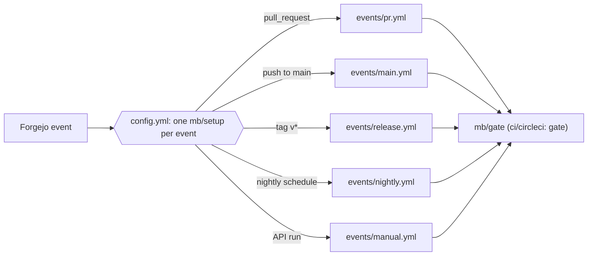
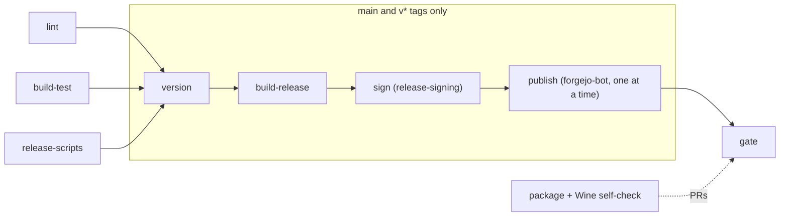
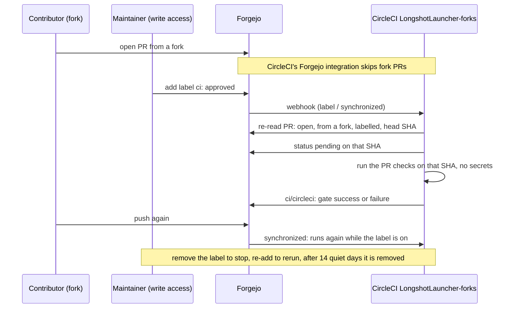

# CI

CircleCI posts Forgejo statuses `ci/circleci: <job>`. Branch protection requires **`ci/circleci: gate`**. Setup,
fork doorbell, cache, commit subjects, policy check, and release sign/publish use **`mb: magicbeandev/ci@0.1.2`**
(source: [MagicBeanDev/orb](https://git.magicbean.dev/MagicBeanDev/orb)).

PR **title and description** checks run on **Forgejo** (`.forgejo/workflows/`); CircleCI does not duplicate them.

## Forgejo Actions

Forgejo's own workflows, in `.forgejo/workflows/`, on the same runners and with the same rules as MagicBeanDev/Longshot's
(its docs/dev/reference/ci.md). `release.yml` is the live publisher.

| Workflow | When | What it does |
|---|---|---|
| `ci.yml` | Pull request, push to `main`, by hand | `changes` (*What the change needs*): whether the build jobs run; `lint`: actionlint (`.actionlint.yml`), ShellCheck on `scripts/`, gitleaks (`.circleci/gitleaks.toml`), the JSON files parse; `build-test` (*Compile and test*): `dotnet build` in locked mode, `tests/test_launcher_core.py --strict --pinned` against the Longshot commit `tests/longshot.ref` pins, Tooling's `tests/test_release.py` at `.tooling-rev` with `LAUNCHER` this checkout; `package`: `scripts/package.sh` (setup, portable zip, AppImage), then the Windows program's `--self-check` under Wine, as a release builds them |
| `pr-title.yml` | Pull request (opened, edited, pushed) | The title is a Conventional Commit, by Tooling's `release.py` at main's `.tooling-rev`. Not in `ci.yml`, so a title edit doesn't cancel the code's checks |
| `release.yml` | Push to `main`, tag `v*` | The nightly or the stable: the version, the launcher (`scripts/package.sh`, the Wine check), sign and publish ([releases](releases.md), [RELEASING.md](../RELEASING.md)) |

Runner labels: `quick` (`changes`, `lint`, the title: a few minutes, on a runner kept free for them), `ubuntu-latest`
(`build-test`, `package`: no secrets), `release` (the release's build, only the server's release runner) and `deploy`
(the release's version and publish, on the seal broker's network). A pull request's code never runs on `release` or
`deploy`.

### What a pull request runs

`changes` reads the pull request's files from the API with the **base's** `scripts/ci_changes.py` (a pull request can't
skip its own checks; a base without the script runs everything). `build-test` and `package` are skipped when every
changed file is in its `DOCS_ONLY` (`docs/`, the top-level documents, `.circleci/`, `.chunk/`, the forge's templates and
`pr-title.yml`); `package` runs only when a file of its `PACKAGE` changes (`scripts/package.sh`, the app's project,
manifest and Windows code, the packages and the SDK, the CI's own files). `lint` always runs. A push to `main` or a run
by hand runs everything, and so does anything unsure (an API that doesn't answer). A skipped job counts as passed. A
pull request's newer push cancels its older run.

### Caches

Each runner keeps its own cache. `ci.yml`'s jobs read it on every run and write it only on a push to `main`, so a pull
request never writes what another run reads.

| Cache (key) | What it holds | Who reads it |
|---|---|---|
| `dotnet-sdk-<global.json, ci_dotnet.sh>` | the .NET SDK's archive, checked by its SHA-512 every time it is used ([scripts/ci_dotnet.sh](../scripts/ci_dotnet.sh)) | `build-test`, `package` |
| `nuget-<global.json, Directory.Packages.props, packages.lock.json>` | NuGet's packages folder (`NUGET_PACKAGES`), each package checked against its lock file by the locked restore; the newest entry restored when the locks change | `build-test` |
| `nuget-package-<the same>` | the same, with the runtime packs the single-file publishes add; starts from `nuget-` when it has no entry | `package` |
| `longshot-<tests/longshot.ref>` | the pinned Longshot commit, the folders the core's tests read (sparse, depth 1, no other blobs); `--pinned` checks its commit | `build-test` |
| `lint-tools-<mise.lock>` | mise.lock's actionlint, ShellCheck and gitleaks archives, checked by mise.lock's SHA-256 every time they are used ([scripts/ci_lint_tools.sh](../scripts/ci_lint_tools.sh)) | `lint` |
| `appimagetool-<scripts/package.sh>` | `package.sh`'s pinned appimagetool and runtime, which it checks by their SHA-256 | `package` |

**The release's cache.** `release.yml`'s build keeps `release-downloads-<global.json, ci_dotnet.sh, package.sh>`: the
SDK's archive and the AppImage tools, the downloads only, each checked by its hash every time it is used, so a cache can
cost a download but never change what is built and signed. It is restored and saved only by a run of `main` or a `v*`
tag, on the release runner. Nothing unpacked or compiled is kept, and NuGet's packages are not cached for a release
(their check rests on files the cache itself would hold). The sign and publish job reads no cache.

**Why no CI image.** Longshot's jobs run in images (`longshot-ci-checks`, `longshot-ci-lite`) because they install
compilers, Rust and pre-commit's hooks, gigabytes, in every job. Here a job adds only the .NET SDK (one archive) and
three small linters to the runners' own Ubuntu 24.04, which already has Python, git and curl; with those downloads
cached and checked, an image would save seconds a job, and cost a second workflow, a registry token and the
image-or-fallback logic to keep. Wine (the `package` job and the release's build) is installed in the background while
`package.sh` builds, so it costs no wait.

### Uploads

The release's build uploads its files through the server's own address first (`RELEASE_UPLOAD_API`'s host, given to
upload-artifact as `ACTIONS_RESULTS_URL`), not recompressed (`compression-level: 0`), then through the public address
behind Cloudflare, then once more. The publish job fetches them from the server's own address first (`release.py
artifacts`), then by download-artifact.

## How it flows



Each setup job compares the changed files with `mapping.conf` and only turns on the areas that changed. A path with no rule turns on nothing, so a change to only such paths runs lint and the gate. The diff is against the merge base with `origin/main` (`HEAD~1` on main).



PRs run lint, build-test, release-scripts, package and dotnet-format, then `gate`. Main and tags add the release chain, which starts only after the checks pass.

**Publishing is dry-run until cutover.** `config.yml` sets `release_dry_run` to true for pushes to main and `v*` tags, so CircleCI signs with a throwaway key and does not publish. Forgejo's `.forgejo/workflows/release.yml` stays the only live publisher until cutover, so the two never write or prune the same release.

**`contract-longshot-main` is advice only.** It runs on the nightly and on main against Longshot's `main`, but nothing waits for it (neither `version` nor `gate` requires it) and its check ends in `|| true`, so it cannot fail a build or stop a release.

### Fork pull requests

CircleCI does not build fork PRs from Forgejo, so a second CircleCI project (`LongshotLauncher-forks`) on this same repo runs `.circleci/forks.yml`. It is started by a Forgejo webhook. Jobs that run fork code get no secrets; the doorbell, stale sweep and status-report jobs hold the bot token and run main's code and the orb, never fork code.



## Setup routing (`config.yml`)

One `mb/setup` job per event; filters are mutually exclusive (on `pipeline.event.name`):

| Workflow | Filter | Event file |
|---|---|---|
| `pr` | `event.name == pull_request` | `events/pr.yml` |
| `main` | `event.name == push`, branch `main`, no tag | `events/main.yml` (`extra-params` sets `nightly: true`) |
| `release` | tag matches `^v.*` | `events/release.yml` (`force-full: true`) |
| `nightly` | `event.name == schedule` and `nightly: true` | `events/nightly.yml` |
| `manual` | `event.name == api` | `events/manual.yml` |
| `noop-*` | non-`v` tag; schedule without `nightly`; push to non-`main` branch | `setup-noop` (no continuation) |

## File map

| Path | Role |
|---|---|
| `.circleci/config.yml` | `mb/setup` per event + `setup-noop` |
| `.circleci/forks.yml` | `mb/fork-doorbell` (webhook) or `mb/fork-stale` (schedule) |
| `.circleci/shared.yml` | Executors, Launcher jobs, `orbs.mb` |
| `.circleci/events/*.yml` | Workflows per event |
| `.circleci/mapping.conf` | path-filtering mapping |
| `.circleci/gitleaks.toml` | Gitleaks (`mise`) |
| `tests/test_launcher_core.py` | Python + C# harness; `--pinned` for Longshot pin |
| Tooling's `tests/test_release.py` | Tooling's `scripts/release.py` harness, at `.tooling-rev`, with `LAUNCHER` this checkout (unittest; **pytest** + junitxml in CI) |
| `tests/longshot.ref` | Longshot commit for `--pinned` |

Longshot checkout in jobs: sparse paths the contract reads → `git fetch --depth 1 --filter=blob:none origin <ref>` → `checkout FETCH_HEAD`.

**Lint:** `mb/commit-subjects`, `mb/policy-check` (`shared`, `events-dir`, `forks`; Rego policies ship in the orb). YAML/JSON sanity uses `yq` and `jq`, not inline Python.

**JUnit:** `release-scripts` runs `python -m pytest <Tooling>/tests/test_release.py --junitxml=…` (Tooling cloned at `.tooling-rev`) after `pip install --require-hashes -r tests/requirements-pytest.txt` (same as `mise run test`). `build-test` / `contract-longshot-main` use `test_launcher_core.py` as pass/fail job output only. The C# side is a console harness today; when it moves to xUnit, use `dotnet test --logger "junit;LogFilePath=..."` in CI.

## Fork PR approval (sticky label)

**LongshotLauncher-forks** (`.circleci/forks.yml`):

| Trigger | Job | When |
|---|---|---|
| Custom webhook | `mb/fork-doorbell` | `stale_sweep` is false (default) |
| Daily schedule (`stale_sweep: true`) | `mb/fork-stale` (`days: 14`) | `stale_sweep` is true |

Forgejo repo webhook (one per repo) on the LongshotLauncher-forks URL: **Pull request label** and **Pull request synchronized** (JSON). Forgejo only lets people with write access add labels, so adding **`ci: approved`** is the approval. The doorbell re-reads the PR from the API (open, from a fork, labelled, head SHA matches `refs/pull/N/head`), posts `pending`, and continues with `events/fork.yml` (`fork_pr` / `fork_sha`, no secrets). The label is sticky: each new push runs again while it is on. An event for a SHA that already has a gate status is ignored, unless the label was re-added since. Remove the label to stop; re-add it to rerun. After **14 days** with no push and no new approval, `mb/fork-stale` removes the label and comments once.

## Local

Require **mise 2026.11.3** (same pin as `mb/setup-mise` in the orb). Tasks use `shell = "bash -c"` in `mise.toml` so `mise run …` works on Ubuntu without extra env.

```bash
mise run setup
mise run lint
mise run test
export MB_ORB_DIR=/path/to/orb   # local MagicBeanDev/orb checkout
mise run validate
```

`mise run validate` calls the orb repo's `tools/validate.sh` (packs orb as `mb`, merges each event, conftest). Policy checks in CI use the same orb policies via `mb/policy-check`; pre-commit does not run them locally.

**Main / manual releases:** `events/main.yml` and `manual-dry-run` call `mb/release-publish` without `tag` (empty parameter). The orb reads `TAG` and `REF` from `/tmp/ws/release.env` written by the `version` job. Tag pushes (`events/release.yml`) pass `tag: << pipeline.git.tag >>`.
