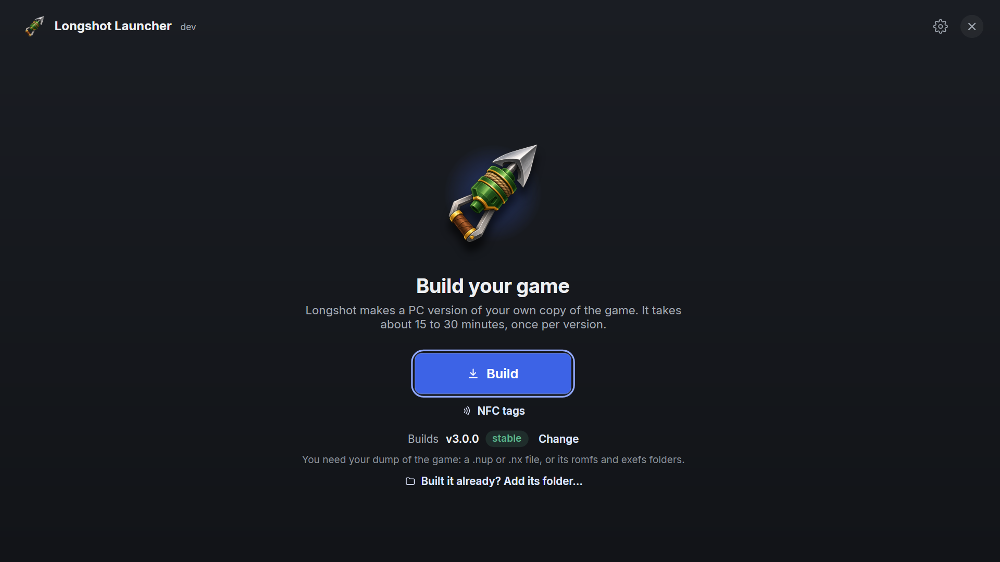

# A controller, and the TV view

The launcher can be used with a controller alone: in Steam's Gaming Mode on a Steam Deck or a ROG Ally, from Big Picture on
a TV, or at a desk ([#1186](https://git.magicbean.dev/MagicBeanDev/Longshot/issues/1186)).

  

| | |
|---|---|
| **D-pad or left stick** | Moves to the next control that way. Held, it repeats |
| **A** | Presses the control: a button, a switch, a choice; opens a list, then chooses in it |
| **B** | Closes an open list; otherwise presses the dialog's Cancel, Keep or Decline, or the page's Back (the arrow left of its title), or returns to Home from a tab |
| **LB / RB** | The previous and next control in order, for one no direction reaches |
| **Right stick** | Scrolls the page or the list |

The first press focuses the home's **Play** (or **Build**, **Update**, or **Build it again** for a version whose game is missing), a
page's main button (on the Versions page, the first version card's first action: its update, Build it again or Set as
default; with no version, Build), or a dialog's safe button (Keep, Cancel, Decline). From Play,
up moves to the home's pickers: the version and the save slot (the profile is the title bar's). A page with neither (Settings, Saves, NFC,
the backups, the save editor) starts on its main list or its first setting: the language, the
first slot's Progress, the first category. A dialog or a menu that marks its main control starts there instead of on
its safe button: the profile menu on New profile… (B closes it), a profile's name box. While a dialog is open the focus stays in it. The Settings cog is in the
title bar.

**Back.** A page that leads back has a round arrow left of its title. B presses it, and so does **Esc** on the keyboard; while
a controller is in use (the TV view, or once a controller was pressed) the arrow wears B's glyph. The tabs' pages (Saves, Versions, Profiles,
NFC, Storage, Settings) have none: B there is the title bar's Home.

## Which controllers

- **Windows**: any XInput controller (Xbox ones, and any controller Steam presents as one), up to four.
- **Linux**: every gamepad under `/dev/input` the user can read (the desktop gives the person at the PC access to them). A
  controller Steam hides from what it starts (`SDL_GAMECONTROLLER_IGNORE_DEVICES`) is skipped: Steam's own copy of it is
  read. Two copies of one press, a few milliseconds apart, count once.
- When something already turns the controller into keys (Steam's desktop layout sends the arrows, Enter and Escape), the
  launcher sees each press twice; after the second time it leaves the controller to that layout.

## The TV view

Started from Steam's Gaming Mode or Big Picture (Steam sets `SteamGamepadUI` or `SteamTenfoot`) or in a gamescope session,
the window fills the screen, with no Minimize, square corners, and the pages scaled up to the screen's height (a wider
screen gives them a little more width). **F11** goes full screen and back anywhere. `LONGSHOT_LAUNCHER_TV=1` turns the TV
view on anywhere, `=0` off.

## The window's corners

The window has its platform's corners: 8 px on Windows 11, square on Windows 10, 12 px on GNOME, 8 px on other Linux
desktops, square in gamescope. Full screen, maximized, in the TV view, or on a desktop that cannot draw a see-through
window (its corners would show black), they are square, and the window drops its border.

The rules are `Core/Gamepad.cs` (and the readers, `Core/GamepadReaders.cs`); the window's side is `App/PadInput.cs` and
`MainWindow.Shape`. tests/launcher_core/PadChecks.cs checks them, and that every page and dialog has a button B presses
(`c:Pad.Back="True"`).
