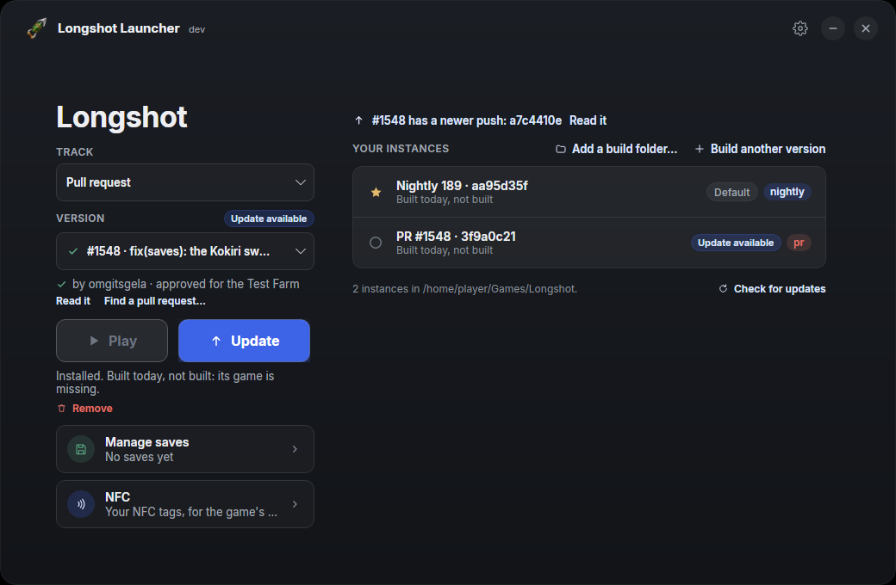

# Pull request builds

The home's **Pull request** track builds an open Longshot pull request on the tester's PC, next to their other versions,
so a change can be played on real hardware before it is merged. It builds a pull request the way the Test Farm's agents
([Beanstalk](https://git.magicbean.dev/MagicBeanDev/Beanstalk)) do: the pull request's source, over the build tools of
`main`.

<p align="center">
  
</p>

## Picking one

- **Track: Pull request.** The Version list shows the pull requests already installed, then the open ones a BigBean wrote
  or approved, each with its title. *Find a pull request…* takes any other open one by its number (`1558`, `#1558`) or its
  link as copied from the browser.
- A draft (Forgejo's mark, or a `WIP:` title) is not listed, nor one labelled for the other system only (`platform/windows`;
  `platform/linux` or `platform/steam-deck`).
- **Switching.** Picking another pull request builds it in place of the one installed, in its folder
  (`builds/pr/pr-<number>-<commit>`, renamed). *Build another version* still builds one beside it.
- **Updates.** A pull request's only update is a newer push of the same pull request: *Update available*, and *Read it*
  opposite the title instead of What's new. No channel's version updates to or from a pull request's build.
- Once it is merged or closed, its row says so. The build stays until the player deletes it.

## The warnings

Every build of new pull request code comes after a warning. A rebuild of a push already built does not.

| The pull request | Warnings |
|---|---|
| Written by a BigBean, or its head approved for the Test Farm | One: what a pull request is, that its code is built and run on this PC, that saves are shared (export them first), and who vouches for it |
| Any other | The same first one, then a second, in red: nobody who reviews Longshot has looked at this code, it runs with the player's rights. **Cancel** is the default; **Build it anyway** goes on |

Approval is pinned to a commit, as on the Test Farm, so a newer push of an approved pull request is not approved until a
BigBean approves it again. Updating to that push shows both warnings again.

## Where the facts come from

The launcher asks **Beanstalk**, not git.magicbean.dev:

```
GET https://beanstalk.magicbean.dev/api/v1/public/pulls
{"generated_at": "...", "pulls": [{"number", "title", "author", "head", "draft", "labels", "updated_at",
                                   "author_bigbean", "approved", "approved_by"}, ...]}
```

- **Only Beanstalk can say who is a BigBean.** git.magicbean.dev's team, member and collaborator lists need a token, and
  the launcher has none. Beanstalk's bot reads BigBeans, and its database has the live approvals of each head commit.
- **It costs git.magicbean.dev nothing.** Beanstalk answers from its own copy of the open pull requests (at most a minute
  old) and caches its answer for a minute (`Cache-Control: public, max-age=60`). The launcher asks once per update check,
  only when a pull request's build is installed, once for all of them. It also asks when the track is picked, at most once
  a minute.
- **Only the build itself touches git.magicbean.dev**, once per push: it downloads the source.

## The build

`pr-<number>-<first 8 hex of the head>` is the version (`Versions.PullRequestOf`), on the `pr` track.

1. Its pull request is read again: it must still be open, out of draft, for this system and at that very commit; a newer
   push is refused ("pick it again").
2. **The newest nightly's tools** are installed the usual way, checked against that nightly's signed release (or kept from
   an installed version).
3. **The source:** `archive/<full commit hash>.tar.gz` from git.magicbean.dev (about 20 MB, capped at 128 MB). It must name
   that commit in its header, and hold plain files only, nothing outside its folder.
4. **`Toolchains.InstallPullRequest`** makes `toolchains/pr-<number>-<commit>`:
   - the nightly's tools, **hard-linked** (about 50 MB of new disk beside the nightly's 900 MB);
   - each top folder of the nightly's tools the source has too (`nx2`, `host`, `gpu`, `scripts`, `third_party`, ...),
     replaced by the source's;
   - the native helpers a release builds into `third_party` that the source lacks, **copied**, never linked, so rebuilding
     one leaves the nightly's alone;
   - its record keeps only the parts no source file replaced, so a later version may reuse its tools but never its source.

   It is **refused when the pull request's `tools.lock` asks for other tools** than the nightly's for this system, as
   Beanstalk refuses to judge one: its build would need tools nobody checked.
5. The wizard's other steps are as for any version.

**Builds stay fast.** A pull request's build uses the same work folder as every other build, so Longshot's lift and object
stores (`LONGSHOT_LIFT_STORE`, `LONGSHOT_OBJ_STORE`) apply. The translation is keyed by the translator and its settings, not
the version, so a pull request that leaves `nx2/` alone takes the nightly's translation instead of translating again, and
the objects nothing changed are reused. Its game files are linked from another build of the same dump
(`LONGSHOT_ROMFS_FROM`), and its tools are links to the nightly's.

Nothing of a pull request is downloaded before its warnings: the early tools download (`ToolsPrefetch`) skips pull
requests.

## Risk

The pull request's build scripts and its game run on the tester's PC with the tester's rights, without the Test Farm's
sandbox. The launcher fetches only the commit Beanstalk names as the head, by its full hash, over https, and checks the
archive is of it. The warnings say who, if anyone, vouches for the code.
